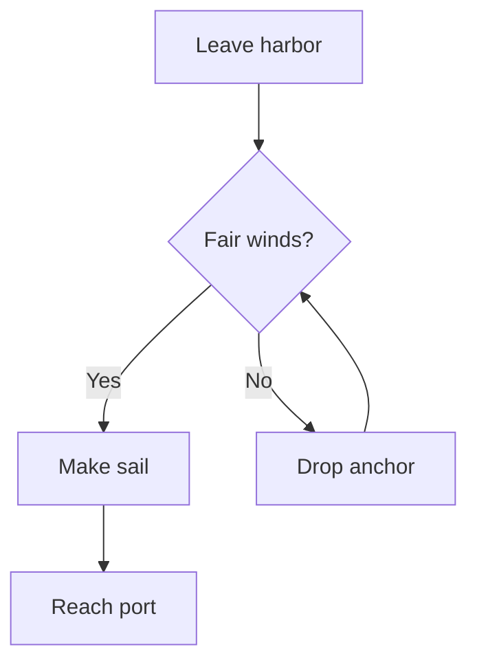
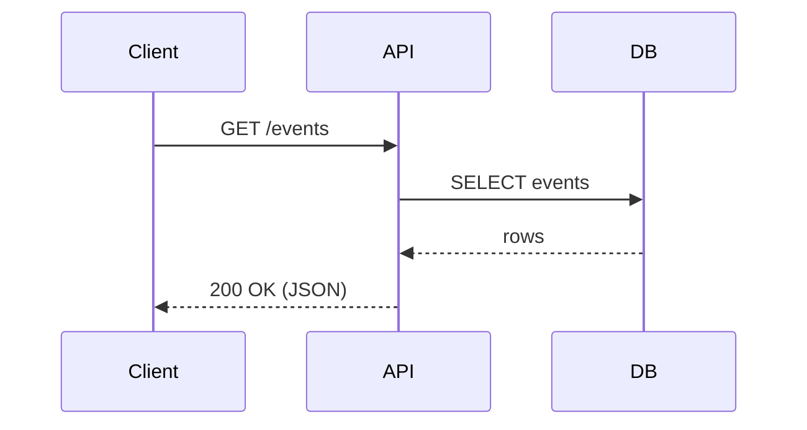
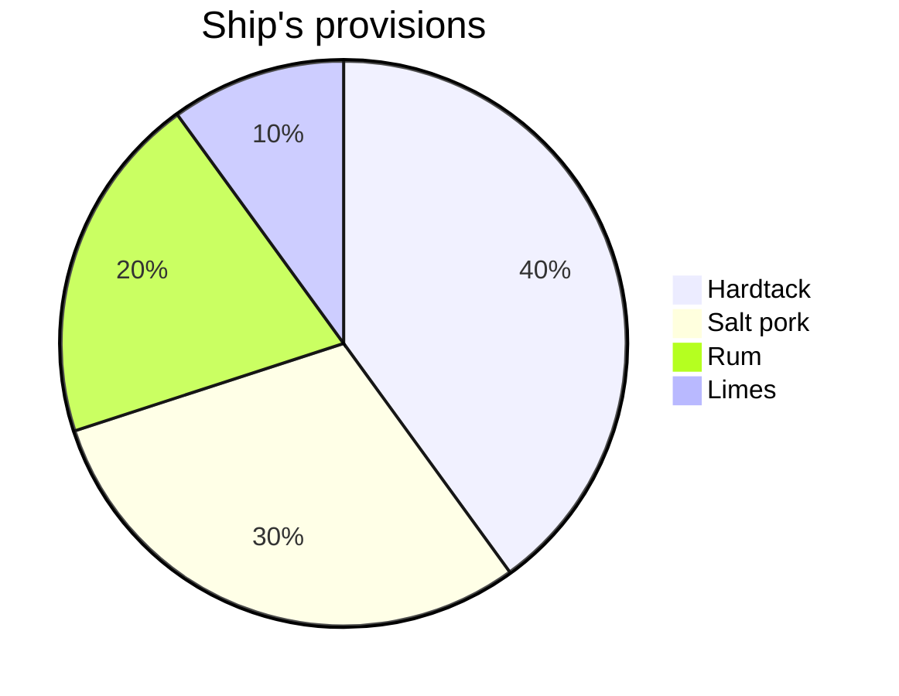

# GitHub Markdown Showcase

A tour of the rich rendering GitHub supports beyond plain Markdown.

## Diagrams

### Mermaid — flowchart



### Mermaid — sequence diagram



### Mermaid — pie chart



### GeoJSON — interactive map

```geojson
{
  "type": "FeatureCollection",
  "features": [
    {
      "type": "Feature",
      "properties": { "name": "Safe harbor" },
      "geometry": {
        "type": "Point",
        "coordinates": [-9.1393, 38.7223]
      }
    },
    {
      "type": "Feature",
      "properties": { "name": "Charted waters" },
      "geometry": {
        "type": "Polygon",
        "coordinates": [
          [
            [-10.0, 38.0],
            [-10.0, 39.5],
            [-8.5, 39.5],
            [-8.5, 38.0],
            [-10.0, 38.0]
          ]
        ]
      }
    },
    {
      "type": "Feature",
      "properties": { "name": "Sailing route" },
      "geometry": {
        "type": "LineString",
        "coordinates": [
          [-9.1393, 38.7223],
          [-12.0, 37.0],
          [-16.9, 32.65]
        ]
      }
    }
  ]
}
```

### TopoJSON — interactive map

```topojson
{
  "type": "Topology",
  "objects": {
    "waters": {
      "type": "GeometryCollection",
      "geometries": [
        {
          "type": "Polygon",
          "properties": { "name": "Western sound" },
          "arcs": [[0, 1]]
        },
        {
          "type": "Polygon",
          "properties": { "name": "Eastern sound" },
          "arcs": [[-1, 2]]
        }
      ]
    }
  },
  "arcs": [
    [[2.0, 50.0], [2.0, 52.0]],
    [[2.0, 52.0], [0.0, 52.0], [0.0, 50.0], [2.0, 50.0]],
    [[2.0, 52.0], [4.0, 52.0], [4.0, 50.0], [2.0, 50.0]]
  ]
}
```

The two polygons share a border arc (`0`, reversed as `-1`). Sharing arcs like that is what sets TopoJSON apart.

### STL — interactive 3D model

```stl
solid tetrahedron
  facet normal 0.0 0.0 -1.0
    outer loop
      vertex 0.0 0.0 0.0
      vertex 1.0 1.0 0.0
      vertex 1.0 0.0 0.0
    endloop
  endfacet
  facet normal 0.0 -1.0 0.0
    outer loop
      vertex 0.0 0.0 0.0
      vertex 1.0 0.0 0.0
      vertex 0.5 0.5 1.0
    endloop
  endfacet
  facet normal 0.894 0.0 0.447
    outer loop
      vertex 1.0 0.0 0.0
      vertex 1.0 1.0 0.0
      vertex 0.5 0.5 1.0
    endloop
  endfacet
  facet normal -0.707 0.707 0.0
    outer loop
      vertex 1.0 1.0 0.0
      vertex 0.0 0.0 0.0
      vertex 0.5 0.5 1.0
    endloop
  endfacet
endsolid tetrahedron
```

## Extras

### Tables

| Crew      | Role        | Aligned right |
| :-------- | :---------: | ------------: |
| Navigator | Charts      |             1 |
| Rustbeard | Sage        |             2 |
| Leadline  | First mate  |             3 |

### Task lists

- [x] Chart the course
- [x] Load provisions
- [ ] Find the treasure

### Strikethrough

~~Sail west~~ Sail east.

### Autolinks

https://github.com renders as a link with no brackets needed.

### Footnotes

The kraken was sighted at dawn.[^kraken]

[^kraken]: Reported by the lookout, who may have had too much rum.

### Alerts

> [!NOTE]
> Useful information worth noticing even when skimming.

> [!TIP]
> Helpful advice for doing things better.

> [!IMPORTANT]
> Key information needed to succeed.

> [!WARNING]
> Urgent info that needs immediate attention.

> [!CAUTION]
> Advises about risks or negative outcomes.

### Math

Inline: the hull speed is roughly $v \approx 1.34\sqrt{L}$ knots.

Block:

$$
\sum_{k=1}^{n} k = \frac{n(n+1)}{2}
$$

Fenced:

```math
\int_0^{2\pi} \sin^2\theta \, d\theta = \pi
```

### Syntax highlighting

```kotlin
fun hoist(sail: Sail): Outcome<Sail> {
    return if (sail.isFurled) Ok(sail.unfurl()) else Ok(sail)
}
```

### Collapsible section

<details>
<summary>Open the captain's log</summary>

Day 42: Still no land. Morale holds, rum does not.

Markdown **works** inside here, as long as there's a blank line after `<summary>`.

</details>